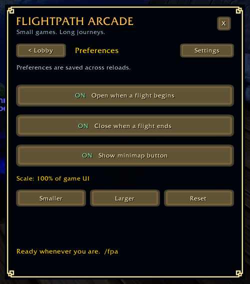

# Flightpath Arcade

Four small, dependency-free native WoW games for flightpaths: Minesweeper, gem matching, Snake, and memory pairs. Version 1.3.2.

- Open from `/fpa` or the winged cyan gem minimap button
- Automatically open when your flight starts and pause when you land
- Play ten gem-matching levels with animated swaps and cascades
- Adjust the window size and save your preferences
- Includes all artwork; no extra libraries or media downloads

## Compatibility

Built for **World of Warcraft: Forever beta, 1.60.x**, Interface **16001**. Beta client updates may affect compatibility.

## Install

1. Exit WoW. Extract the ZIP.
2. Copy its **FlightpathArcade** folder into the Forever client's `Interface/AddOns` folder. The final path must be `Interface/AddOns/FlightpathArcade/FlightpathArcade.toc`; avoid an extra nested folder.
3. Enable Flightpath Arcade in the character-selection AddOns list and log in. No libraries, media downloads, or game installation changes are required by this package.

Use `/fpa` or the winged cyan gem minimap button. `/fpa settings` opens preferences. Drag the window background to move it.

## Play

- **Minesweeper:** left click to reveal, right click to flag. Find all 54 safe squares around ten mines. Your first reveal and its neighbors are safe.
- **Gem matching:** click neighboring gems to swap them. Match three or more, build cascades, and reach the target within 20 moves. Invalid swaps are free. Beat ten levels, with targets rising from 600 to 1,050. The HUD tracks your level, score, target and moves.
- **Snake:** press Resume, then use arrows or WASD. Eat apples and avoid walls and yourself. Space or Escape pauses and releases the keys; Escape may also close the window. Clickable arrows let you play without capturing normal movement and chat keys. Combat pauses keyboard play and releases capture.
- **Memory pairs:** click cards to find eight matching rune pairs. Mismatches turn back after a short peek.

Pause and Resume let you take a break. Closing the window keeps the current board until reload or logout; reopening starts paused. Lobby pauses the current game. Gem matching keeps its round when you switch games: choose Continue to return. Selecting another game starts a fresh board.

### Gem matching levels

Reach the target to unlock **Next level** after the last cascade finishes. **Retry level** starts a fresh board at the same level; **New run** returns to level one. Winning on your last move still counts. Finish level ten to complete the run. If you run out of moves below the target, retry or start again.

## Match-3 scoring

Each unique gem cleared awards **10 points**: three gems score 30, four score 40 and five score 50. There is no extra four/five-match bonus or cascade multiplier. Every later cascade adds 10 points per gem; a three-gem clear followed by four gems scores 70 in total. Intersecting matches count shared gems once per clear. One valid swap costs one move regardless of cascade count; invalid swaps cost none.

| Level | 1 | 2 | 3 | 4 | 5 | 6 | 7 | 8 | 9 | 10 |
| --- | --- | --- | --- | --- | --- | --- | --- | --- | --- | --- |
| Target | 600 | 650 | 700 | 750 | 800 | 850 | 900 | 950 | 1000 | 1050 |

Every level starts with 20 moves and zero score. Random boards mean success is not guaranteed.

## Settings and flight behavior

Open `/fpa settings` to choose whether the arcade opens when a flight begins, closes when it ends, and shows its minimap button. All three options start on. Opening the taxi map alone does not launch the arcade.

Closing the window during a flight keeps it closed until the next flight. Landing always pauses play and releases keyboard focus; your auto-close setting decides whether the window closes too. Reloading mid-flight opens the lobby when auto-open is enabled. Turning auto-open on mid-flight applies to your next flight.

Use **Smaller**, **Larger** and **Reset** to set the window scale from 75% to 150% of the game UI. The window automatically fits smaller viewports; Reset restores 100%. Drag the background to move it.

Preferences survive reload and logout; active games and window position do not. The minimap button has a fixed position and can overlap other addons. `/fpa` still works when the button is hidden.

## Screenshots

Updated in-game captures of the launcher, all four games and preferences.

| Gem matching | Minesweeper |
| --- | --- |
|  |  |

| Memory pairs | Snake |
| --- | --- |
|  |  |

## Credits

**Artwork by [Kenney](https://kenney.nl).** Thank you, Kenney, for making these game assets available under [Creative Commons CC0](https://creativecommons.org/publicdomain/zero/1.0/). We credit the creator even though CC0 does not require attribution.

| Kenney pack | Used in Flightpath Arcade |
| --- | --- |
| [Puzzle Pack 1](https://kenney.nl/assets/puzzle-pack-1) | Match-3 gems and minimap gem |
| [Platformer Assets Base](https://kenney.nl/data/itch/preview/) (bundle catalog name) | Bomb and flag |
| [Animal Pack Remastered](https://kenney.nl/assets/animal-pack-remastered) | Snake head and body artwork |
| [Board Game Icons](https://kenney.nl/assets/board-game-icons) | Apple |
| [Rune Pack](https://kenney.nl/assets/rune-pack) | Memory pairs |
| [Fantasy UI Borders](https://kenney.nl/assets/fantasy-ui-borders) | Window and result-panel borders |
| [UI Pack - Adventure](https://kenney.nl/assets/ui-pack-adventure) | Button skins |
| [Tiny Ski](https://kenney.nl/assets/tiny-ski) | Frost Run characters, hazards and scenery |

Selected artwork is resized, recolored or adapted for the addon; the original CC0 notices remain bundled. Original addon code, covered tiles, card backs and minimap wings/backing are credited separately to Flightpath Arcade contributors under MIT. Kenney artwork retains its CC0 status.

## License

Original addon code is available under the [MIT license](LICENSE). Selected Kenney artwork is CC0; see [asset provenance](FlightpathArcade/Media/CREDITS.md) and the eight unmodified [source notices](FlightpathArcade/Media/Licenses). Original artwork has its own MIT notice in Media. Only selected redistributable textures are included. World of Warcraft and Blizzard imagery belong to their respective rights holders. This project is unofficial and not endorsed by Blizzard.
