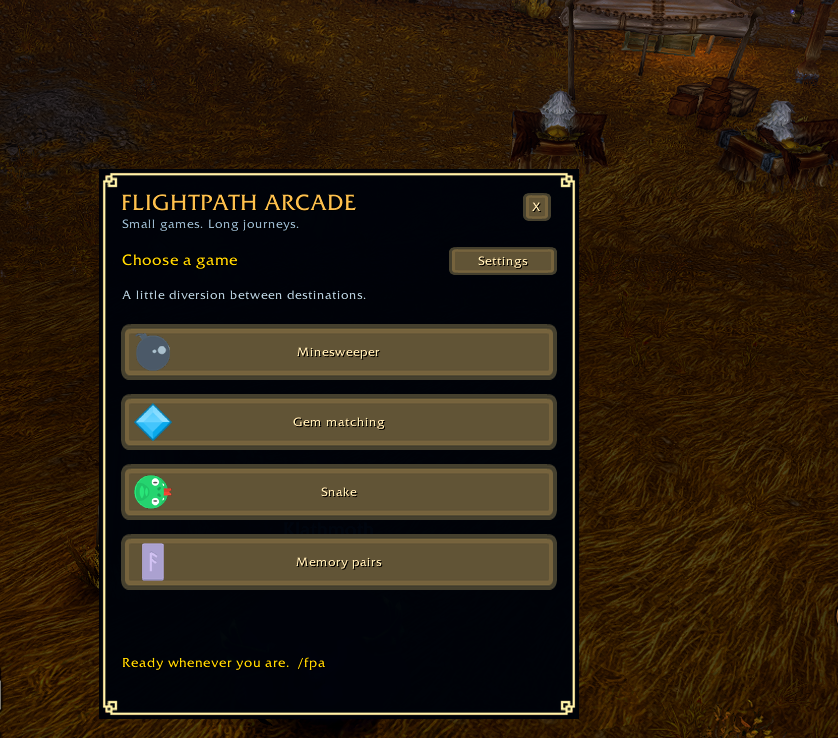
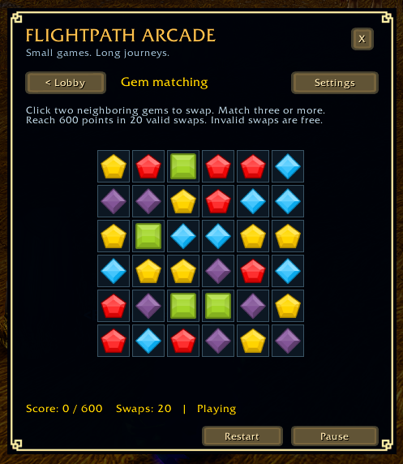
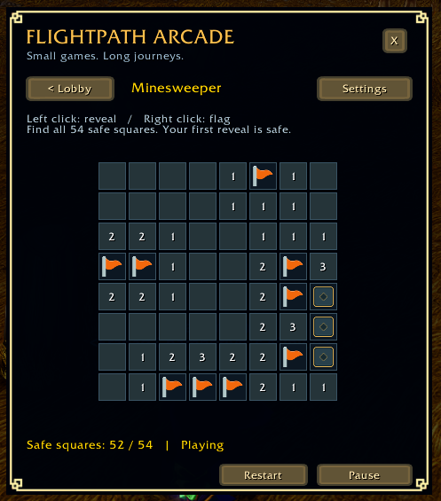
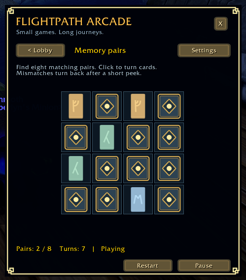
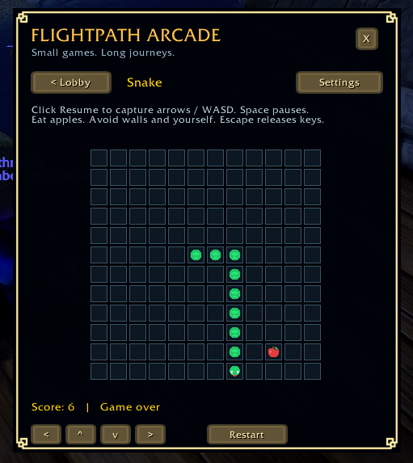

# Flightpath Arcade

Four small, dependency-free native WoW games for flightpaths: Minesweeper, gem matching, Snake, and memory pairs. Version 1.2.0.

## Credits

**Artwork by [Kenney](https://kenney.nl).** Thank you, Kenney, for making these game assets available under [Creative Commons CC0](https://creativecommons.org/publicdomain/zero/1.0/). We credit the creator even though CC0 does not require attribution.

| Kenney pack | Used in Flightpath Arcade |
| --- | --- |
| [Puzzle Pack 1](https://kenney.nl/assets/puzzle-pack-1) | Match-3 gems and minimap gem |
| [Platformer Assets Base](https://kenney.nl/data/itch/preview/) (bundle catalog name) | Bomb and flag |
| [Animal Pack Remastered](https://kenney.nl/assets/animal-pack-remastered) | Snake head and body artwork |
| [Board Game Icons](https://kenney.nl/assets/board-game-icons) | Apple |
| [Rune Pack](https://kenney.nl/assets/rune-pack) | Memory pairs |
| [Fantasy UI Borders](https://kenney.nl/assets/fantasy-ui-borders) | Window and result-panel borders |
| [UI Pack - Adventure](https://kenney.nl/assets/ui-pack-adventure) | Button skins |

Selected artwork is resized, recolored or adapted for the addon; the original CC0 notices remain bundled. Original addon code, covered tiles, card backs and minimap wings/backing are credited separately to Flightpath Arcade contributors under MIT. Kenney artwork retains its CC0 status.

## Screenshots

Actual in-game screenshots from an earlier build, preserved unchanged. The Match-3 view predates the 1.2.0 level HUD and result panels. Snake's older help text says "gold squares"; the current version correctly says "apples".

| Gem matching (before 1.2.0 levels) | Minesweeper |
| --- | --- |
|  |  |

| Memory pairs | Snake |
| --- | --- |
|  |  |

## Match-3 scoring

Each unique gem cleared awards **10 points**: three gems score 30, four score 40 and five score 50. There is no extra four/five-match bonus or cascade multiplier. Every later cascade adds 10 points per gem; a three-gem clear followed by four gems scores 70 in total. Intersecting matches count shared gems once per clear. One valid swap costs one move regardless of cascade count; invalid swaps cost none.

| Level | 1 | 2 | 3 | 4 | 5 | 6 | 7 | 8 | 9 | 10 |
| --- | --- | --- | --- | --- | --- | --- | --- | --- | --- | --- |
| Target | 600 | 650 | 700 | 750 | 800 | 850 | 900 | 950 | 1000 | 1050 |

Every level starts with 20 moves and zero score. Random boards mean success is not guaranteed.

## Compatibility

Targets **Blizzard World of Warcraft: Forever beta, 1.60.x**, Interface **16001**. The beta may change; compatibility with the latest client build is not yet verified. Earlier builds received in-game testing; the 1.2.0 level/result flow requires the checklist below.

Compatibility references:

- Blizzard's September 22 beta announcement identifies 1.60.1 build 69977: https://us.forums.blizzard.com/en/wow/t/beta-client-update-september-22/2358655
- Questie's Forever TOC uses 16001: https://raw.githubusercontent.com/Questie/Questie/master/Questie_Camelot.toc
- Forever shares Retail's project ID; version/interface detection is used instead: https://raw.githubusercontent.com/Questie/Questie/master/Modules/QuestieCompat.lua
- Pinned 1.60.1.70009 Blizzard UI API snapshot exposes UnitOnTaxi: https://raw.githubusercontent.com/Gethe/wow-ui-source/bd2470aed543f72697a044e989285b6c83e63f73/Interface/AddOns/Blizzard_APIDocumentationGenerated/UnitDocumentation.lua

The pinned snapshot establishes API evidence, not the latest installed beta version. Flight detection samples UnitOnTaxi on world/control events and every 0.5 seconds. Opening the taxi map does not trigger the arcade. Optional event registration is guarded.

## Install

1. Exit WoW. Extract the ZIP.
2. Copy its **FlightpathArcade** folder into the Forever client's `Interface/AddOns` folder. The final path must be `Interface/AddOns/FlightpathArcade/FlightpathArcade.toc`; avoid an extra nested folder.
3. Enable Flightpath Arcade in the character-selection AddOns list and log in. No libraries, media downloads, or game installation changes are required by this package.

Use `/fpa` or the winged cyan gem minimap button. `/fpa settings` opens preferences. Drag the window background to move it.

## Play

- **Minesweeper:** left click reveals; right click toggles a flag. Reveal 54 safe cells around ten mines. The first reveal and its neighbors are safe.
- **Gem matching:** select two adjacent faceted gems. Match three or more to score; cascades count. Each of ten levels has 20 valid swaps: targets rise from 600 to 1,050 in steps of 50. Score resets each level. Invalid swaps cost nothing; unplayable boards regenerate automatically. The HUD shows level, score/target and moves. A **Level complete!** panel appears only after the final cascade settles, with Next level, Retry level and Back to lobby. Out of moves offers Retry level, New run and Back to lobby. Winning on the last move counts as a win. Level ten completes the run; New run returns to level one. Board clicks are locked throughout animation and results. Pause, close, landing and combat freeze animation; reopening requires Resume. Retry level replaces the current board at the same level; New run resets progress to level one.
- **Snake:** press Resume to capture arrows or WASD. Eat red apples, avoid walls and yourself. Space or Escape releases capture and pauses; Escape may also close the window through WoW's standard window handler. Clickable arrow controls also start/resume play without acquiring keyboard focus. Use these to keep normal movement/chat bindings available. Keyboard Resume is unavailable in combat. Entering combat pauses and releases captured keys; clickable directions remain available.
- **Memory pairs:** uncover eight rune pairs; mismatches remain visible for 0.8 seconds of active play.

Restart creates a new board (Retry level in gem matching). Lobby pauses the current game. Gem matching retains its round when switching games; select its Continue card to return paused, or return to the unchanged result panel after completion. Other game selections start new boards. Close preserves the current board in memory. Reopening always pauses; Resume continues. Wins and losses release keyboard capture.

## Settings and flight behavior

All three settings default on and persist in `FlightpathArcadeDB`: open when flight begins, close when flight ends, and show the minimap button. The slash command works with the button hidden. Mid-flight reload opens the lobby if auto-open is enabled. Closing manually during flight prevents reopening until the next flight. Landing always pauses and releases keyboard focus; auto-close decides whether the window also closes. This also applies to a window opened manually during flight. Turning auto-open on mid-flight takes effect on the next flight.

Settings also provides a saved window scale from 75% to 150%, relative to the game UI, with Smaller, Larger and Reset (100%) controls. The window fits within UIParent logical dimensions with margins, preserves square cells, and recenters when display size or game UI scale changes. It does not confuse physical pixels with UI units or resize the minimap button. If the chosen size cannot fit, Settings indicates auto-fit; very small viewports may reduce text size below the chosen setting. At 1080p with normal game UI scale, the default window fits without reduction.

Only preferences survive reload/logout; active games and window position do not. The minimap button uses a fixed position and may overlap other addons. The bundled artwork uses three padded TGA textures of selected Kenney CC0 and original MIT artwork (784 KiB combined texture data); see Media/CREDITS.md and Media/LICENSE.txt. There are no sounds, global key bindings, network calls, or background game simulations. A lightweight flight observer remains active while hidden. Up to 144 cell buttons are allocated once and reused. Snake advances at most once per rendered frame, so a severe hitch slows it rather than catching up unexpectedly. Normal WoW chat and movement are available whenever Snake's explicit keyboard capture is inactive.

## Development and testing

Native Lua and WoW frames; no runtime dependencies or external downloads. The addon observes flights at 0.5-second intervals and updates games only while shown and unpaused. Pooled controls and three texture atlases keep allocation and asset size small.

From the repository root, run `lua tests/run.lua` with an existing Lua interpreter (Lua 5.1 recommended). The deterministic rules and mock WoW UI harness require no WoW installation. `python tests/check_level_scope.py` checks preserved rules/settings/assets. `python scripts/package.py` validates load files and makes the install ZIP in `dist/`; it includes only the addon folder, documentation and licenses, never tests, screenshots, repository metadata or source asset collections. Python is required only for packaging, not gameplay.

The retuned 1.2.0 implementation passed the full 9,590-assertion deterministic rules/mock UI suite and independent scoring/boundary checks under Lua 5.4. Structural/package and preserved-scope checks also pass. Tests and development tools are in the source repository, not the install ZIP. Mock tests do not verify actual client behavior: earlier builds received in-game testing, while the 1.2.0 level/result flow still requires the checklist below.

### In-game checklist

1. Enable Lua errors, log in, open `/fpa`, and verify layout at your UI scale; resize the game viewport and move the window.
2. Open/close the taxi map without flying: arcade stays closed. Take a flight: opens once. Close mid-flight: stays closed. Take another flight: opens again.
3. Exercise every combination of auto-open/auto-close, including manual opening during a flight; land during Snake and verify movement/chat recover immediately.
4. Hide the minimap button, use `/fpa settings`, restore it, reload on ground and in flight, and verify settings persist without duplicate windows.
5. Play each game to a win/loss; restart, return to lobby, close/reopen mid-game. Check Minesweeper flags and first-click safety, invalid gem swaps, Snake reverse-turn prevention, and memory mismatch pause/resume.
6. Verify Snake keyboard capture occurs only after Resume, releases on Pause/Space/Escape/hide/landing/game over, and clickable directions work without capture. Check chat entry and normal movement afterward. Enter combat while capturing keys; confirm immediate release, blocked keyboard Resume, and working clickable controls.
7. In gem matching, verify moving gems stay above the tile backgrounds throughout every phase; verify a valid swap visibly travels, matched gems pulse and clear, survivors fall, and new gems enter from above. Check an invalid swap returns, rapid clicks are ignored, cascades score once, and pause/close/landing/combat freeze every stage. Retry and switch games mid-fall; return to gem matching and confirm the retained round resumes without skipping any phases. Verify all four games display artwork without atlas bleeding at your UI scale.
8. Check the single window border, close-button clearance, left-aligned heading and button hover/press/disabled states. Test saved Smaller/Larger/Reset at 1080p and after changing game resolution/UI scale; confirm all controls remain visible, cells square, and the minimap button unchanged.
9. Win on the last move and during a multi-cascade swap: the completion panel must wait for every animation and show the final score. Rapidly click Next level: advance exactly once. Check Retry level, New run, Back to lobby, switching games, close/reopen, flight-end and combat interruptions. Exhaust moves below target and verify the loss panel; complete level ten and verify New run returns to one.
10. Leave the addon closed through several flights. Confirm no errors, no unintended reopening, and stable memory/CPU using the client's addon profiling tools if available.

Beta release candidate: perform this checklist before treating the addon as in-game verified.

## License and credits

Original addon code is available under the [MIT license](LICENSE). Selected Kenney artwork is CC0; see [asset provenance](FlightpathArcade/Media/CREDITS.md) and the seven unmodified [source notices](FlightpathArcade/Media/Licenses). Original artwork has its own MIT notice in Media. Only selected redistributable textures are included. World of Warcraft and Blizzard imagery belong to their respective rights holders. This project is unofficial and not endorsed by Blizzard.
